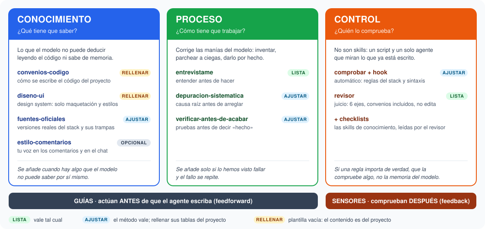
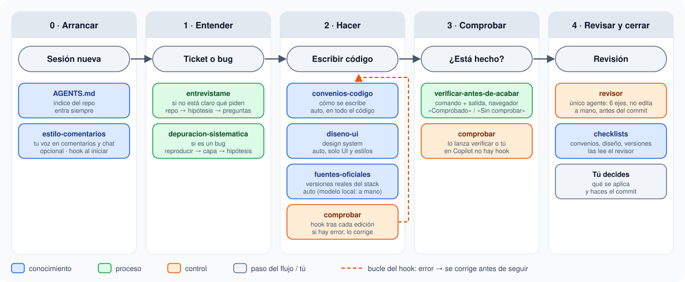
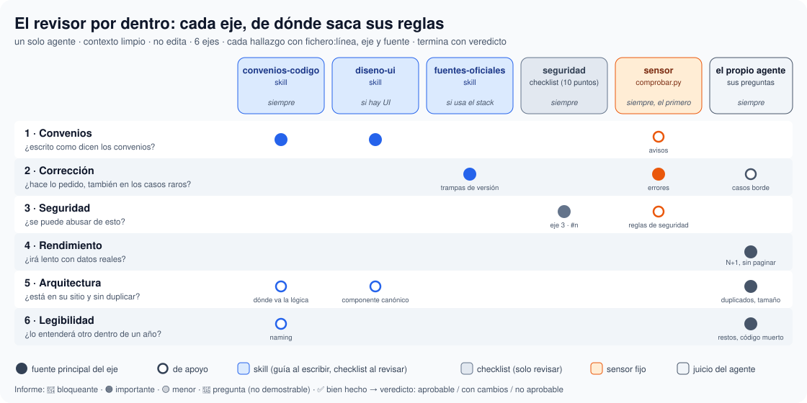

# Guía del core: qué hace cada pieza, cuándo entra y qué hay que rellenar

Esta guía es el **mapa de uso** de la plantilla: qué piezas trae, de qué tipo es cada una, en qué momento del trabajo actúa y cuánto hay que rellenar para un proyecto nuevo. Cómo se monta está en el [README](README.es.md); de dónde sale cada cosa, en [INVESTIGACION](INVESTIGACION.md).

> **La idea en una línea:** agente = modelo + harness. Las **guías** le dicen al agente qué saber y cómo trabajar *antes* de escribir; los **sensores** comprueban *después* lo que ha escrito. Solo guías: reglas que nadie comprueba. Solo sensores: un agente que repite los mismos fallos.

---

## 1. Los 3 tipos de pieza



| Tipo | Pregunta | Qué cubre | Piezas |
|---|---|---|---|
| 🔵 **Conocimiento** | ¿qué tiene que saber? | lo que el modelo no puede deducir leyendo el código ni sabe de memoria | `convenios-codigo`, `diseno-ui`, `fuentes-oficiales`; opcional: `estilo-comentarios` |
| 🟢 **Proceso** | ¿cómo tiene que trabajar? | las manías del modelo: inventarse requisitos, parchear a ciegas, decir "hecho" sin probar | `entrevistame`, `depuracion-sistematica`, `verificar-antes-de-acabar` |
| 🟠 **Control** | ¿quién lo comprueba? | mirar lo que ya está escrito, con una herramienta (fijo) o con otro modelo (juicio) | `comprobar` + hook, `revisor` |

Conocimiento y proceso son **guías** (skills, `SKILL.md`). Control son **sensores**: no son skills, sino un script y **un solo agente**. El revisor usa las skills de conocimiento como checklists (§6).

**Estado en la plantilla:**
- **LISTA:** vale tal cual.
- **AJUSTAR:** el método vale; hay que rellenar sus tablas del proyecto.
- **RELLENAR:** plantilla vacía; el contenido es del proyecto.
- **OPCIONAL:** fuera del core (`estilo-comentarios`).

## 2. Qué es el core


**Core = lo que aplica a cualquier tarea del proyecto, sea el módulo que sea:**

> **6 skills + 1 sensor + 1 agente**, sobre `AGENTS.md`

| Pieza | Qué es | Estado en la plantilla |
|---|---|---|
| **6 skills** | conocimiento: `convenios-codigo`, `diseno-ui`, `fuentes-oficiales`. Proceso: `entrevistame`, `depuracion-sistematica`, `verificar-antes-de-acabar` | 2 RELLENAR, 3 AJUSTAR, 1 LISTA |
| **1 sensor** | `comprobar` + hook | AJUSTAR (`MARCADOR`, `REGLAS`…) |
| **1 agente** | `revisor` | LISTA |
| **base** | `AGENTS.md`, el índice que entra siempre | `AGENTS.plantilla.md` |

Se puede ver también por de dónde sale el contenido:
- **Del proyecto:** `AGENTS.md`, `convenios-codigo`, `diseno-ui`, la tabla de `fuentes-oficiales` y las `REGLAS` del sensor. Se rellena para cada proyecto, o se apunta al repo del equipo si ya lo tiene.
- **Del método:** las tres skills de proceso, el motor del sensor y el agente `revisor`. Valen para cualquier proyecto sin tocarlos (o casi).

**Opcional · fuera del core:**
- **Personal:** `estilo-comentarios`, tu voz en comentarios y chat. Cada uno tendría el suyo.
- **Lo de un módulo o pantalla concreta:** skills que solo entran bajo demanda, con una `description` muy precisa para que no se disparen en cualquier tarea.
- **Lo que está en espera:** commits, planes de ticket, traducciones, migraciones, recibir revisiones. Solo entran si algo falla de verdad y se repite (§6).

## 3. El flujo de trabajo



| Fase | Qué pasa | Piezas |
|---|---|---|
| **0 · Arrancar** | al abrir sesión entra el índice del repo y tu forma de hablar | `AGENTS.md` (siempre), `estilo-comentarios` (hook `SessionStart` en Claude) |
| **1 · Entender** | si no está claro qué piden: preguntas de una en una, mirando antes el repo. Si es un bug: reproducir, localizar la capa y una hipótesis cada vez | `entrevistame`, `depuracion-sistematica` |
| **2 · Hacer** | escribe con los convenios, el design system si es UI y las versiones reales del stack. **Tras cada edición**, el hook pasa el comprobador: si hay error, Claude lo corrige antes de seguir (el bucle naranja) | `convenios-codigo`, `diseno-ui`, `fuentes-oficiales`, `comprobar` |
| **3 · Comprobar** | antes de decir "hecho": comando ejecutado y salida leída, o el navegador si es una pantalla. Lo que no se pueda probar se dice: «Sin comprobar» | `verificar-antes-de-acabar` (+ el comprobador a mano en Copilot) |
| **4 · Revisar y cerrar** | revisión a fondo con contexto limpio, convenios incluidos, usando las skills de conocimiento como checklists. No edita: decides tú qué se aplica y haces el commit | `revisor` |

Si en la fase 3 algo no está hecho, se vuelve a la 2. Si en la 2 aparece un bug, se pasa por `depuracion-sistematica`.

**Este flujo es el que recibe el modelo**, en versión corta (el orden de las fases, el sensor y el agente): es el contenido de `claude\CLAUDE.md`, que el hook `SessionStart` inyecta en cada sesión de Claude, y de `copilot\<proyecto>.instructions.md`, que Copilot (chat de VS Code y CLI) carga siempre desde `~/.copilot` por hardlink. Es el **router**: dice *cuándo* entra cada pieza; el *qué* se queda en cada skill. No se repite en `AGENTS.md`: Claude cargaría los dos y el flujo saldría duplicado. El router entra siempre, pero solo marca el orden: que cargue cada skill sigue dependiendo de su `description` (o de escribir `/nombre`).

**Cómo se escribe el router:** con órdenes cortas atadas a cada momento ("**ANTES** de escribir código: carga los convenios", "**DESPUÉS** de cada cambio: lanza el sensor", "**ANTES** de decir hecho: enseña la salida"). Probado con un modelo local: con un router descriptivo se saltaba convenios y sensor; con este formato los cumplió.

## 4. Fichas

### 🔵 `convenios-codigo` · RELLENAR
- **Qué:** cómo se escribe el código del proyecto: stack, nombrado, dónde va la lógica, base de datos, frontend, anti-patrones y formato.
- **Qué rellenar:** las secciones de la plantilla, con reglas de una línea que valgan siempre (700 palabras como mucho). Si el equipo ya tiene convenios en su repo, solo un puntero a ese fichero.
- **Entra:** sola, antes de escribir o revisar cualquier código.

### 🔵 `diseno-ui` · RELLENAR
- **Qué:** el design system: tokens, componentes canónicos, patrones de pantalla, responsive.
- **Qué rellenar:** las secciones. Si crece, un índice aquí y el detalle en ficheros al lado que se lean bajo demanda.
- **Entra:** sola, **solo** con maquetación, estilos o componentes de UI.

### 🔵 `fuentes-oficiales` · AJUSTAR
- **Qué:** las versiones reales del stack, sus trampas y el orden para informarse: repo → trampas → doc oficial de esa versión.
- **Tapa:** que el modelo escriba de memoria la última versión de cada librería. Visto en la práctica: un modelo local metió `slot-scope` (Vue 2.5) en un proyecto con Vue 2.3: el slot salía vacío sin avisar.
- **Qué rellenar:** la tabla del stack (versión, dónde se ve, doc de esa versión) y las trampas, una línea por trampa con lo que **sí** se usa.
- **Entra:** sola con modelos buenos. Con modelos locales pequeños, a mano: `/fuentes-oficiales`.

### 🔵 `estilo-comentarios` · OPCIONAL (fuera del core)
- **Qué:** tu voz: cómo quieres los comentarios (longitud, tono, cuándo sí y cuándo no) y el tono del chat.
- **Qué rellenar:** tus reglas, y en el detalle, **ejemplos reales tuyos**. Si no te importa cómo comenta el agente, bórrala.
- **Entra:** al empezar la sesión: en Claude, por el hook `SessionStart`; en Copilot, porque se lo pide su router. Si no, `/estilo-comentarios`.

### 🟢 `entrevistame` · LISTA
- **Qué:** cuando un ticket no está claro, ni para el agente ni para ti. Primero **mira en el repo** qué hace hoy eso; luego hipótesis con %, **una pregunta cada vez con su suposición**, y un resumen con la línea "Fuera" obligatoria. Lo que solo sabe el cliente va a una lista de **preguntas para el cliente**.
- **Opcional:** lo que suele faltar en los tickets de ese proyecto.
- **Entra:** cuando se lo pides ("entrevístame", "no sé a qué se refiere este ticket") o si el ticket no deja claro el qué, para quién o por qué. Nunca en tareas mecánicas.

### 🟢 `depuracion-sistematica` · AJUSTAR
- **Qué:** sin causa raíz no hay arreglo. Reproducir → seguir el dato por las capas → una hipótesis cada vez → un solo arreglo. **Con 3 arreglos fallidos, para**: el problema es de diseño.
- **Qué rellenar:** la tabla de capas de la aplicación y cómo mirar cada una, y las trampas propias del proyecto.
- **Entra:** sola, ante un bug o un error, antes de proponer ningún arreglo.

### 🟢 `verificar-antes-de-acabar` · AJUSTAR
- **Qué:** nada de "hecho" sin una prueba ejecutada en ese mismo mensaje, y una salida honrada: «Comprobado» / «Sin comprobar».
- **Tapa:** visto en la práctica: un modelo potente dijo "validado sin errores de editor" sin haber ejecutado nada.
- **Qué rellenar:** las filas de la tabla con los comandos reales (tests, lint, build…).
- **Entra:** sola, al ir a dar algo por terminado o antes de un commit.

### 🟠 `comprobar` + hook · AJUSTAR
- **Qué:** `personal\scripts\comprobar.py`, solo con la librería estándar.
  - Pasa las `REGLAS` (regex con `ERROR` o `AVISO`) **solo por las líneas cambiadas** respecto a HEAD, no por el fichero entero: así el código antiguo no hace ruido y se pueden meter convenios de estilo (`var`, líneas largas…) sin miles de avisos. Para auditar un fichero completo, `--todo`.
  - Compila los `.py` con el Python del proyecto.
  - Pasa `node --check` por los `.js` que no lleven plantillas.
- **Qué rellenar:**
  - `MARCADOR`: un fichero que solo exista en ese repo. Obligatorio si convives con otros proyectos.
  - `PYTHON_PROYECTO`.
  - `REGLAS`: las trampas de `fuentes-oficiales` que se puedan pillar con una regex. Es la forma más fiable de que no se repitan.
- **Entra:**
  - **Claude:** automático, tras **cada** edición (hook `PostToolUse` del plugin). Un error le llega como bloqueante y lo corrige antes de seguir.
  - **Copilot:** no hay hook; lo lanza `verificar` o tú:
    ```bash
    py -3 <HARNESS>/personal/scripts/comprobar.py
    ```
    (Sin argumentos revisa lo cambiado en git.)

### 🟠 `revisor` · LISTA
- **Qué:** el **único agente** del harness. Revisa a fondo con contexto limpio, en 6 ejes. **No edita:** cada hallazgo va con `fichero:línea`, su eje y su fuente, y el arreglo propuesto (lo mecánico, como cambio exacto); termina con un veredicto. Las fuentes que sigan sin rellenar, se las salta y lo dice.



- **Fuentes por eje:** el esquema de arriba es la tabla que lleva el propio agente. La regla es **aplicar cada fuente solo a sus ejes**:
  - `convenios-codigo` → 1, 5 y 6;
  - `diseno-ui` → 1 y 5;
  - `fuentes-oficiales` → 2;
  - `checklists\seguridad.md` → 3, citada como `eje 3 · #n`;
  - el sensor → 2 (errores) y 1 (avisos).

  Rendimiento y casi toda la legibilidad son juicio del agente.
- **Skill o checklist:** "checklist" no es un tipo de fichero, sino cómo usa el revisor una fuente. Las skills de conocimiento hacen dos papeles: el agente principal las carga **antes** de escribir (guía) y el revisor las lee **después** como checklist. Lo que solo sirve para revisar (hoy, seguridad) va en `personal\checklists\`: no entra en ningún catálogo ni lo carga el agente principal. Si un día hace falta que guíe también al escribir, se sube a skill.
- **Qué ajustar:** la columna "cómo se ve en el código" de `checklists\seguridad.md`. Opcional: las trampas del proyecto que hay que mirar siempre y otras checklists propias en `personal\checklists\`.
- **Entra:** a mano, antes del commit o de la PR, o para revisar una rama.

## 5. Cómo entra cada pieza

| Pieza | Claude Code | Copilot (VS Code) |
|---|---|---|
| `AGENTS.md` | siempre, al arrancar | siempre |
| `estilo-comentarios` | hook `SessionStart` | se lo pide el router al empezar; si no, `/estilo-comentarios` |
| `convenios-codigo`, `diseno-ui` | sola, por su `description` | sola |
| `fuentes-oficiales`, `depuracion-sistematica`, `verificar-antes-de-acabar` | sola, por su `description` | sola, con el router marcando el momento; si un modelo local se la salta, `/nombre` |
| `entrevistame` | cuando se lo pides o el ticket es ambiguo | ídem, o `/entrevistame` |
| `comprobar` | **automático** tras cada edición | se lo ordena el router tras cada cambio, o a mano |
| `revisor` | a mano (subagente) | a mano (selector de agentes) |

**Para saber si una skill ha entrado:**
- **Claude:** sale "Habilidad ejecutada /<proyecto>:…" en la respuesta.
- **Copilot:** despliega las referencias usadas de la respuesta y mira si aparece el `SKILL.md`. Para el router: paleta de comandos → "Chat: Configure Instructions" → debe salir `copilot-instructions` (una sola vez).

Si no entra cuando debería, **primero se mejora la `description`** (palabras concretas que enganchen); solo como último recurso se fuerza.

## 6. Antes de añadir algo nuevo

Cada skill cuesta aunque no se use: su `description` está siempre en el catálogo, y cuantas más hay, más se dispara la que no toca. El criterio:

| Tipo | Se añade cuando… | No se añade si… |
|---|---|---|
| 🔵 Conocimiento | hay algo que el modelo **no puede saber** ni deducir del código | ya está en los convenios o se ve leyendo el repo |
| 🟢 Proceso | hemos **visto** al modelo fallar así, y se repite | es "por si acaso" o lo haces tú en diez segundos |
| 🟠 Control | una regla importa y se puede comprobar con una herramienta | depende del juicio de cada caso (eso va al `revisor`) |

Si un fallo concreto se repite, lo primero es ver si cabe como **regla nueva en `REGLAS`**: es lo más fiable y no gasta contexto. Qué se podría añadir si hay señal, y qué conviene no meter, está en el catálogo de [SKILLS-OPCIONALES](SKILLS-OPCIONALES.md).

### Un solo agente; los demás revisores, como skills

Se puso de moda tener muchos revisores (de seguridad, de rendimiento, de accesibilidad…). Aquí no: **un agente nuevo solo compensa** si hacen falta ojos frescos, permisos distintos o aislar un trabajo pesado. Las tres cosas ya las cubren el `revisor` y los agentes de búsqueda que traen las herramientas.

Cada subagente empieza sin contexto, gasta bastantes más tokens y pierde parte de lo que descubre al devolver el resultado. Además, varios revisores repasan el mismo diff varias veces.

**Si hace falta un "revisor de X":**
1. Se escribe como **skill** con su checklist (`revision-accesibilidad`, por ejemplo).
2. Se añade a la tabla de checklists del `revisor`, con su "cuándo".
3. Lo que se pueda comprobar con una regex, a `REGLAS`.

Así sigue habiendo una sola pasada, un solo informe y un agente que no toca el código.

Cómo escribir una skill para que funcione está en el [README §4](README.es.md#4-día-a-día).
