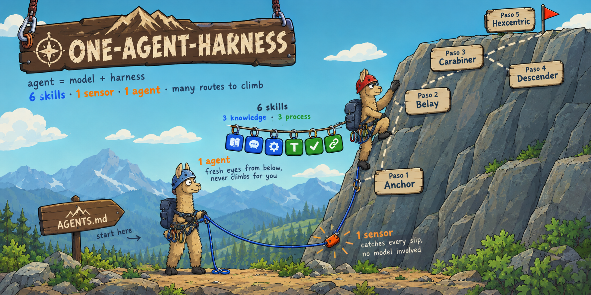
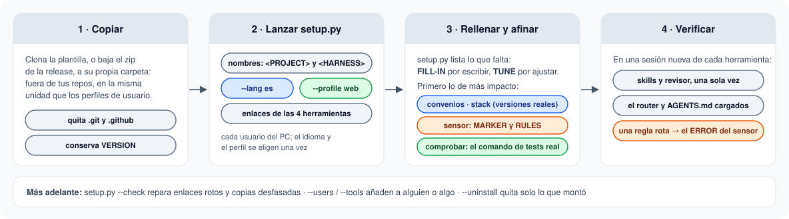
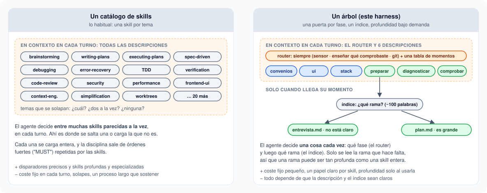
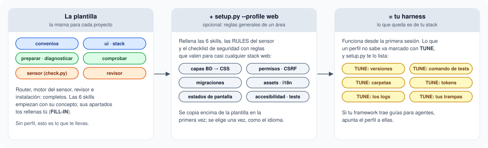
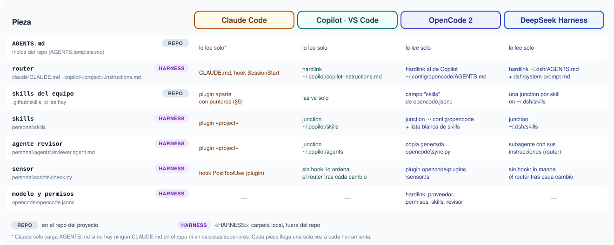
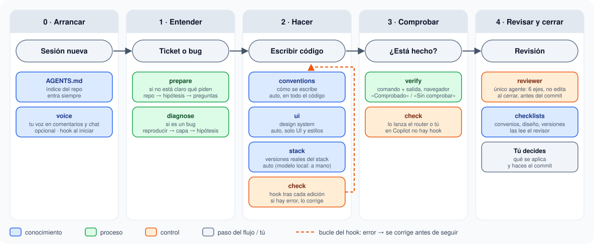

# One Agent Harness

🌐 [English](README.md) · **Español**

<p align="center"></p>

[](https://github.com/robmab/one-agent-harness/actions/workflows/ci.yml)
[](https://github.com/robmab/one-agent-harness/releases)
[](LICENSE)

Plantilla para montar el harness de IA de **cualquier proyecto**: skills, agentes, un sensor automático e instrucciones, compartidos entre todos los usuarios del PC (Windows, Linux o macOS) y entre Claude Code, GitHub Copilot (VS Code), OpenCode 2 y DeepSeek Harness, **sin tocar el workspace** si no quieres.

## De un vistazo

<p align="center"></p>

Se lee de izquierda a derecha, como una cadena de montaje: **la llevas tú**, del ticket al commit, y el harness hace que cada estación cumpla su parte. En discontinuo, lo que puedes activar: un approver automático, un revisor por eje y el **modo fábrica**, en el que los tickets abren su propia sesión y te esperan en una bandeja ([FACTORY](docs/FACTORY.es.md)).

## Instalación rápida

Copia la plantilla a su propia carpeta (fuera de tus repos) y deja que `setup.py` le ponga nombre y la conecte con cada herramienta.

**Windows** (PowerShell):

```powershell
git clone https://github.com/robmab/one-agent-harness.git C:\Harness\MiProyecto
Remove-Item C:\Harness\MiProyecto\.git, C:\Harness\MiProyecto\.github -Recurse -Force
py -3 C:\Harness\MiProyecto\setup.py --project "Mi Proyecto" --lang es
```

**Linux y macOS:**

```bash
git clone https://github.com/robmab/one-agent-harness.git ~/harness/mi-proyecto
rm -rf ~/harness/mi-proyecto/.git ~/harness/mi-proyecto/.github
python3 ~/harness/mi-proyecto/setup.py --project "Mi Proyecto" --lang es
```

Después, rellena lo que te lista (`FILL-IN`, o `TUNE` con un perfil), recarga VS Code y comprueba cada herramienta.

- **Opciones útiles:** `--profile web` (skills, sensor y checklist de seguridad ya rellenos para web), `--lang es` (las piezas en español, con los nombres en inglés; sin ella, todo en inglés), `--tools claude,copilot`, `--vscode-permissions`, `--dry-run`.
- **Más adelante:** `--check` repara los enlaces rotos y `--uninstall` quita lo que montó.



Cada paso y cada opción, los requisitos y cómo hacerlo a mano: **[SETUP](docs/SETUP.es.md)**.

## En uso real, a diario

No es una demo: es el harness que uso **cada día en mi trabajo**, sobre una aplicación web grande, en producción y mantenida por un equipo. La plantilla es ese mismo harness sin lo específico del proyecto, y **evoluciona con él**:

- **Probado en sesiones de trabajo reales** con Claude Code, GitHub Copilot en VS Code (modelos en la nube) OpenCode 2 con un modelo local (llama.cpp) y DeepSeek Harness (DeepSeek V4 Flash).
- **Cada regla sale de algo que pasó de verdad.** Se leen y se miden los logs de sesiones reales, y entra el cambio más pequeño que arregla lo que falló, primero allí y luego aquí. Por ejemplo, el revisor lee solo el diff porque leyendo ficheros enteros se hacía eterno.
- **Al día:** las mejoras salen como [releases](https://github.com/robmab/one-agent-harness/releases), con notas de lo aprendido.

## La idea

**Agente = modelo + harness.** Las *guías* (skills) le dicen al agente qué saber y cómo trabajar **antes** de escribir; los *sensores* comprueban **después** lo que escribió: uno determinista (un script tras cada edición) y otro de juicio (un revisor con el contexto limpio). La división sigue el [harness engineering](https://martinfowler.com/articles/harness-engineering.html) de Birgitta Böckeler. El core es pequeño a propósito:

> **6 skills + 1 sensor + 1 agente**, sobre `AGENTS.md`

| Tipo | Pregunta | Piezas |
|---|---|---|
| 🔵 Conocimiento | ¿qué tiene que saber? | `conventions` (convenios de código), `ui` (sistema de diseño), `stack` (versiones reales del stack y sus trampas) |
| 🟢 Proceso | ¿cómo tiene que trabajar? | `prepare` (aclarar y, si es grande, planificar), `diagnose` (causa raíz antes de arreglar), `verify` (pruebas antes de decir "hecho") |
| 🟠 Control | ¿quién lo comprueba? | `check` + hook (comprobaciones fijas tras cada edición), `reviewer` (el único agente: revisión a fondo, nunca edita), `guard` (un hook que bloquea credenciales, y el revisor antes del cierre) |

Opcional, fuera del core: `voice` (tu propia voz en los comentarios y en el chat) y `retro` (un subagente nuevo repasa cómo le ha ido a cada pieza del harness en una sesión, con pruebas del log, para que el harness mejore, o encoja, con lo que pasa de verdad). Los nombres son los mismos con `--lang es`: se traduce el contenido, no los nombres. Qué hace cada pieza y cuándo entra: **[SKILLS-GUIDE](docs/SKILLS-GUIDE.es.md)**.

Interruptores, en bloques `CHOOSE` y apagados por defecto: un **approver automático** (devuelve al builder lo que encuentra el revisor, hasta 3 rondas), **un revisor por eje** y **otro modelo para el revisor**, para que no comparta los puntos ciegos del builder.

### Una puerta por fase, no un catálogo

La mayoría de colecciones de skills son catálogos: una skill por tema, todas sus descripciones en contexto en cada turno, y el agente eligiendo entre muchas parecidas a la vez. Aquí cada fase tiene **una sola skill**, su página es **un índice** que elige la rama, y el detalle vive en **ficheros aparte que solo se leen cuando hace falta esa rama**. El agente decide una cosa cada vez, y una rama puede ser tan profunda como una skill entera, con el coste fijo de seis descripciones.



Lo nuevo entra como una rama más de la skill a la que pertenece; solo pasa a ser una skill propia cuando su disparador no puede compartir la puerta.

## Qué trae

- **El motor, completo:** un router por herramienta, el sensor (`check.py` + hook), el `reviewer`, la instalación (`setup.py`) y las comprobaciones que lo mantienen todo coherente.
- **Las 6 skills como plantillas:** cada una empieza con su concepto (para qué sirve y qué evita) y deja la parte del proyecto por rellenar. No hay un harness bueno para todo, pero esta estructura sí vale para todos. Las skills de método completas están en [examples](examples/README.es.md), para copiarlas o sacar ideas.
- **Perfiles,** para partir de algo que ya funciona: `--profile web` rellena las skills, el sensor y el checklist de seguridad con reglas que valen para casi cualquier stack web, y marca con `TUNE` lo que conviene ajustar al tuyo.





Cada carpeta y cada fichero, y por dónde encuentra cada herramienta cada pieza: **[STRUCTURE](docs/STRUCTURE.es.md)**.

## Día a día



- **El agente trabaja en orden:** preparar (y planificar si es grande) → hacer, con el sensor tras cada edición → comprobar antes de decir "hecho" → el revisor al cerrar. El commit es tuyo.
- **O que los tickets entren solos:** con el modo fábrica, un script programado convierte cada ticket nuevo en una sesión desatendida en su propia rama, que para antes del código o después de la revisión: **[FACTORY](docs/FACTORY.es.md)**.
- **Añadir algo** (una skill, una regla del sensor, un checklist) solo tras una señal real: conocimiento que el modelo no puede tener, o un fallo visto y repetido.
- **Varios proyectos en un PC,** qué va en cada fichero de instrucciones, cómo escribir una skill que se dispare y los gotchas: **[DAY-TO-DAY](docs/DAY-TO-DAY.es.md)**.

> **Idioma:** la plantilla está en inglés, y `setup.py --lang es` la monta en español; la documentación viene en los dos (`*.es.md`). Escribe las skills, y sobre todo su `description`, **en el idioma en que hablas con el modelo**.

## Documentación

| Documento | Para qué |
|---|---|
| [SETUP](docs/SETUP.es.md) | montar un proyecto: copiar, `setup.py` y sus opciones, rellenar, verificar, mantenerlo, convivir con otros proyectos, montaje a mano |
| [STRUCTURE](docs/STRUCTURE.es.md) | cada carpeta y cada fichero, los marcadores, y por dónde encuentran Claude, Copilot, OpenCode y DeepSeek Harness cada pieza |
| [DAY-TO-DAY](docs/DAY-TO-DAY.es.md) | añadir piezas, qué va en cada fichero de instrucciones, escribir una skill que funcione, gotchas |
| [EXTENDING](docs/EXTENDING.es.md) | añadir otra herramienta, y qué comprueba el CI |
| [SKILLS-GUIDE](docs/SKILLS-GUIDE.es.md) | qué hace cada pieza, de qué tipo es, cuándo entra y qué hay que rellenar |
| [RESEARCH](docs/RESEARCH.es.md) | de dónde sale todo: qué es un harness, repos analizados, skills adaptadas y descartadas |
| [OPTIONAL-SKILLS](docs/OPTIONAL-SKILLS.es.md) | skills opcionales: qué aporta cada una, cuándo compensa y cuáles se desaconsejan |
| [FACTORY](docs/FACTORY.es.md) | opcional: los tickets nuevos abren su propia sesión desatendida y te esperan en una bandeja |
| [examples](examples/README.es.md) | las skills de método completas, para copiar o sacar ideas |

## Licencia y créditos

[MIT](LICENSE). Varias skills y el `reviewer` partieron de [obra/superpowers](https://github.com/obra/superpowers), [addyosmani/agent-skills](https://github.com/addyosmani/agent-skills) y [mattpocock/skills](https://github.com/mattpocock/skills), los tres MIT; cada pieza adaptada cita su origen en su pie, y sus avisos están en [THIRD-PARTY-NOTICES](THIRD-PARTY-NOTICES.md).
