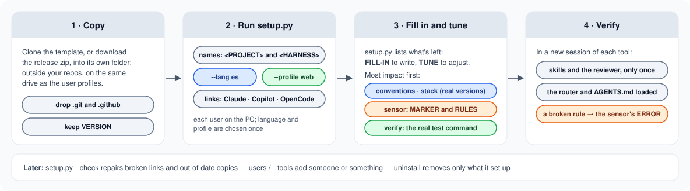
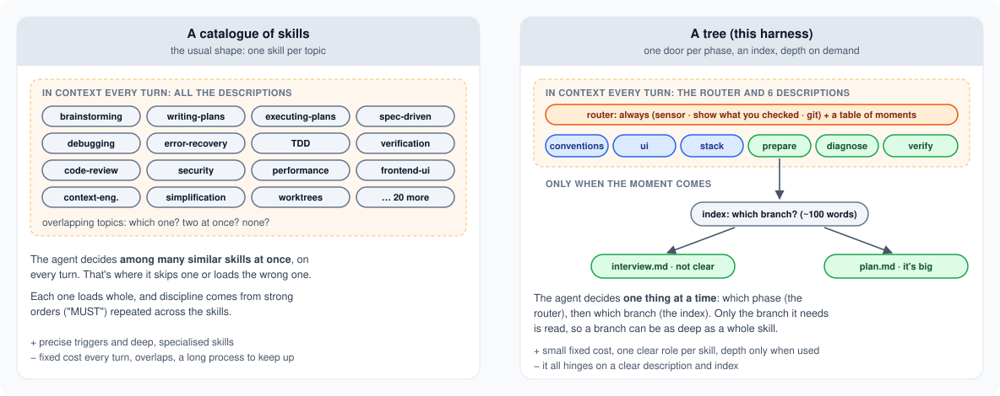
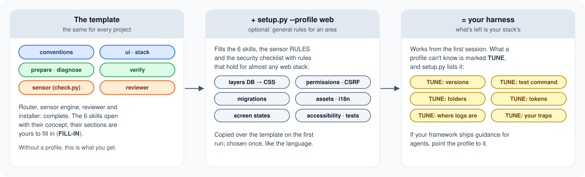
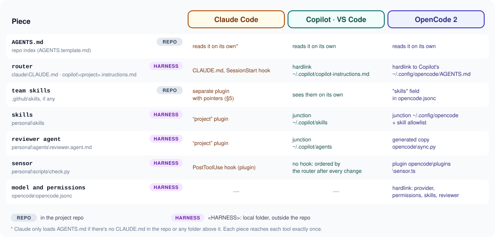
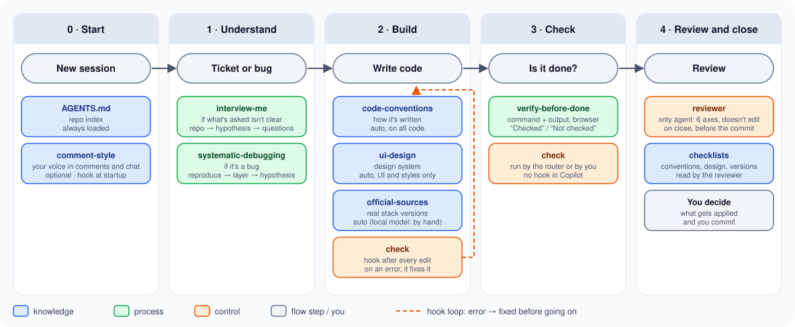

# One Agent Harness

🌐 **English** · [Español](README.es.md)

<p align="center"></p>

[](https://github.com/robmab/one-agent-harness/actions/workflows/ci.yml)
[](https://github.com/robmab/one-agent-harness/releases)
[](LICENSE)

A template for setting up the AI harness of **any project**: skills, agents, an automatic sensor and instructions, shared by every user on the PC (Windows, Linux or macOS) and by Claude Code, GitHub Copilot (VS Code), OpenCode 2 and DeepSeek Harness, **without touching the workspace** if you don't want to.

## At a glance

<p align="center"></p>

Read it left to right, like a production line: **you drive it**, from the ticket to the commit, and the harness makes every station do its job. Dashed, what you can switch on: an automatic approver, one reviewer per axis, and **factory mode**, where tickets open their own session and wait for you in a tray ([FACTORY](docs/FACTORY.md)).

## Quick start

Copy the template to its own folder (outside your repos) and let `setup.py` name it and wire it up for every tool.

**Windows** (PowerShell):

```powershell
git clone https://github.com/robmab/one-agent-harness.git C:\Harness\MyProject
Remove-Item C:\Harness\MyProject\.git, C:\Harness\MyProject\.github -Recurse -Force
py -3 C:\Harness\MyProject\setup.py --project "My Project"
```

**Linux and macOS:**

```bash
git clone https://github.com/robmab/one-agent-harness.git ~/harness/my-project
rm -rf ~/harness/my-project/.git ~/harness/my-project/.github
python3 ~/harness/my-project/setup.py --project "My Project"
```

Then fill in what it lists (`FILL-IN`, or `TUNE` with a profile), reload VS Code and check each tool.

- **Useful options:** `--profile web` (skills, sensor and security checklist already filled in for web), `--lang es` (the pieces in Spanish; the names stay in English), `--tools claude,copilot`, `--vscode-permissions`, `--dry-run`.
- **Later:** `--check` repairs broken links and `--uninstall` removes what it set up.



Every step and option, the requirements and how to do it by hand: **[SETUP](docs/SETUP.md)**.

## In real, daily use

This isn't a demo: it's the harness I use **every day at work**, on a large production web application maintained by a team. The template is that same harness without the project-specific parts, and **it moves with it**:

- **Tested in real work sessions** with Claude Code, GitHub Copilot in VS Code (cloud models) OpenCode 2 with a local model (llama.cpp) and DeepSeek Harness (DeepSeek V4 Flash).
- **Every rule comes from something that actually happened.** The logs of real sessions are read and measured, and the smallest change that fixes what failed goes in, first there and then here. For example, the reviewer reads only the diff because reading whole files made it take forever.
- **Kept up to date:** improvements ship as [releases](https://github.com/robmab/one-agent-harness/releases), with notes on what was learned.

## The idea

**Agent = model + harness.** *Guides* (skills) tell the agent what to know and how to work **before** it writes; *sensors* check **after** what it wrote: a deterministic one (a script after every edit) and a judging one (a reviewer with a clean context). The split follows Birgitta Böckeler's [harness engineering](https://martinfowler.com/articles/harness-engineering.html). The core is deliberately small:

> **6 skills + 1 sensor + 1 agent**, on top of `AGENTS.md`

| Type | Question | Pieces |
|---|---|---|
| 🔵 Knowledge | what does it need to know? | `conventions` (code conventions), `ui` (design system), `stack` (real stack versions and their traps) |
| 🟢 Process | how should it work? | `prepare` (clarify, and plan if it's big), `diagnose` (root cause before fixing), `verify` (evidence before saying "done") |
| 🟠 Control | who checks it? | `check` + hook (fixed checks after every edit), `reviewer` (the only agent: in-depth review, never edits), `guard` (a hook that blocks credentials, and the reviewer before the close) |

Optional, outside the core: `voice` (your own voice for code comments and chat) and `retro` (a fresh subagent reviews how each piece of the harness did in a session, with evidence from the log, so the harness can improve, or shrink, from what really happens). What each piece does and when it kicks in: **[SKILLS-GUIDE](docs/SKILLS-GUIDE.md)**.

Switches, in `CHOOSE` blocks and off by default: an **automatic approver** (it sends the reviewer's findings back to the builder, up to 3 rounds), **one reviewer per axis**, and **another model for the reviewer**, so it doesn't share the builder's blind spots.

### One door per phase, not a catalogue

Most skill collections are catalogues: one skill per topic, every description in context on every turn, and the agent choosing among many similar ones at once. Here each phase has **a single skill**, its page is **an index** that picks the branch, and the detail lives in **side files read only when that branch is needed**. The agent decides one thing at a time, and a branch can be as deep as a whole skill, at the fixed cost of six descriptions.



New knowledge goes in as a new branch of the skill it belongs to; it only becomes a skill of its own when its trigger can't share the door.

## What you get

- **The engine, complete:** a router for each tool, the sensor (`check.py` + hook), the `reviewer`, the installer (`setup.py`) and the checks that keep it all consistent.
- **The 6 skills as templates:** each opens with its concept (what it's for and what it prevents) and leaves the project's part to fill in. No harness is good for everything, but this structure is. The complete method skills are in [examples](examples/README.md), to copy or take ideas from.
- **Profiles,** to start from something that already works: `--profile web` fills the skills, the sensor and the security checklist with rules that hold for almost any web stack, and marks with `TUNE` what's worth adjusting to yours.





Every folder and file, and how each tool finds each piece: **[STRUCTURE](docs/STRUCTURE.md)**.

## Day to day



- **The agent works in order:** prepare (and plan if it's big) → build, with the sensor after every edit → verify before saying "done" → the reviewer when closing. The commit is yours.
- **Or let the tickets come in on their own:** with factory mode, a scheduled script turns each new ticket into an unattended session in its own branch, which stops before the code or after the review: **[FACTORY](docs/FACTORY.md)**.
- **Adding something** (a skill, a sensor rule, a checklist) only after a real signal: knowledge the model can't have, or a failure seen and repeated.
- **Several projects on one PC,** what goes in each instruction file, how to write a skill that triggers, and the gotchas: **[DAY-TO-DAY](docs/DAY-TO-DAY.md)**.

> **Language:** the template is in English, and `setup.py --lang es` sets it up in Spanish; the docs come in both (`*.es.md`). Write the skills, and above all their `description`, **in the language you talk to the model in**.

## Documentation

| Document | What for |
|---|---|
| [SETUP](docs/SETUP.md) | setting up a project: copy, `setup.py` and its options, fill in, verify, keep it in shape, live with other projects, manual setup |
| [STRUCTURE](docs/STRUCTURE.md) | every folder and file, the placeholders, and how Claude, Copilot, OpenCode and DeepSeek Harness find each piece |
| [DAY-TO-DAY](docs/DAY-TO-DAY.md) | adding pieces, what goes in each instruction file, writing a skill that works, gotchas |
| [EXTENDING](docs/EXTENDING.md) | adding another tool, and what the CI checks |
| [SKILLS-GUIDE](docs/SKILLS-GUIDE.md) | what each piece does, what type it is, when it kicks in and what to fill in |
| [RESEARCH](docs/RESEARCH.md) | where it all comes from: what a harness is, repos analysed, skills adapted and discarded |
| [OPTIONAL-SKILLS](docs/OPTIONAL-SKILLS.md) | optional skills: what each adds, when it's worth it, and which ones are discouraged |
| [FACTORY](docs/FACTORY.md) | optional: new tickets open their own unattended session and wait for you in a tray |
| [examples](examples/README.md) | the complete method skills, to copy or take ideas from |

## Licence and credits

[MIT](LICENSE). Several skills and the `reviewer` started from [obra/superpowers](https://github.com/obra/superpowers), [addyosmani/agent-skills](https://github.com/addyosmani/agent-skills) and [mattpocock/skills](https://github.com/mattpocock/skills), all MIT; each adapted piece credits its source in its footer, and their notices are in [THIRD-PARTY-NOTICES](THIRD-PARTY-NOTICES.md).
