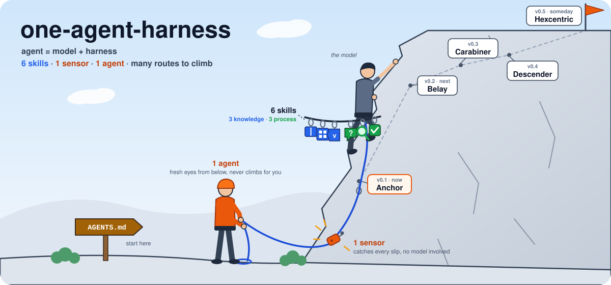
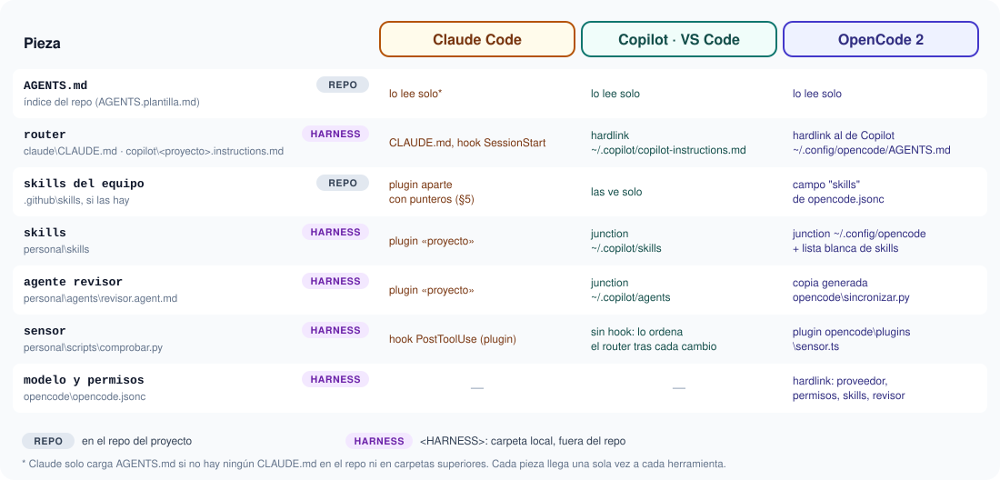

# one-agent-harness

🌐 **English** · [Español](README.es.md)

<p align="center"></p>

[](https://github.com/robmab/one-agent-harness/actions/workflows/ci.yml)
[](https://github.com/robmab/one-agent-harness/releases)
[](LICENSE)

A template for setting up the AI harness of **any project**: skills, agents, an automatic sensor and instructions, shared by every Windows user on the PC and by Claude Code, GitHub Copilot (VS Code) and OpenCode 2, **without touching the workspace** if you don't want to.

It comes from a harness already built and tested on a real project (2026-10-10), with everything specific to that project removed.

> **It is inert:** no tool loads it. You don't use it here: you **copy** it to `<ROOT>\<Project>`, fill it in and wire it up. Every pending piece is marked `RELLENAR` ("fill in").

> **Language note:** this README is in English; the detailed docs (`GUIA-SKILLS`, `INVESTIGACION`, `SKILLS-OPCIONALES`) and the skills themselves are in Spanish. Skill and folder names are identifiers and stay as they are.

**Placeholders used throughout the template:**

| Placeholder | Meaning |
|---|---|
| `<RAIZ>` / `<ROOT>` | the folder where you keep your harnesses. Ideally one that **every Windows user on the PC can read and write** (e.g. a folder inside `C:\Users\Public`) and that sits **outside your repos** |
| `<HARNESS>` | the harness folder of one project: `<ROOT>\<Project>` |
| `<PROYECTO>` / `<proyecto>` | the project name; lowercase with hyphens where it acts as an identifier (plugin, marketplace) |

| Document | What for |
|---|---|
| **README** (this one) | what it contains, how to set up a new project and how to coexist with others |
| [GUIA-SKILLS](GUIA-SKILLS.md) *(ES)* | what each piece does, what type it is, when it kicks in and what has to be filled in |
| [INVESTIGACION](INVESTIGACION.md) *(ES)* | where it all comes from: what a harness is, repos analysed, skills adapted and discarded |
| [SKILLS-OPCIONALES](SKILLS-OPCIONALES.md) *(ES)* | catalogue of optional skills: what each adds, when to add it, the noise it brings, and which ones are discouraged |
| [AGENTS.plantilla.md](AGENTS.plantilla.md) *(ES)* | the index that goes at the root of the project repo |
| [LICENSE](LICENSE) · [THIRD-PARTY-NOTICES](THIRD-PARTY-NOTICES.md) | MIT licence and credits for the adapted skills (§9) |



---

## The idea in one line

**Agent = model + harness.** *Guides* (skills) tell the agent what to know and how to work **before** it writes; *sensors* check **after** what it wrote. The core is deliberately small:

> **6 skills + 1 sensor + 1 agent**, on top of `AGENTS.md`

- **Skills separate topics; agents separate heads.** If the model needs to *know* something, it's a skill. If you need *someone else* who hasn't seen the work (fresh eyes, fewer permissions, or isolating heavy work), it's an agent, and there is only one: the reviewer.
- **What must always hold goes to a deterministic sensor** (a script + hook), not to the model's memory.

| Type | Question | Pieces |
|---|---|---|
| 🔵 Knowledge | what does it need to know? | `convenios-codigo` (code conventions), `diseno-ui` (design system), `fuentes-oficiales` (real stack versions and their traps) |
| 🟢 Process | how should it work? | `entrevistame` (clarify before building), `depuracion-sistematica` (root cause before fixing), `verificar-antes-de-acabar` (evidence before saying "done") |
| 🟠 Control | who checks it? | `comprobar` + hook (fixed checks after every edit), `revisor` (the only agent: in-depth review, never edits) |

Optional, outside the core: `estilo-comentarios` (your own voice for code comments and chat).

## 1. Structure

```
one-agent-harness\
├─ README.md · README.es.md · GUIA-SKILLS.md · INVESTIGACION.md · SKILLS-OPCIONALES.md
├─ LICENSE · THIRD-PARTY-NOTICES.md · .gitattributes
├─ .github\                             CI of this repo (not part of the template; drop it when copying)
├─ VERSION                             template version this harness was copied from
├─ AGENTS.plantilla.md                   → to the repo root as AGENTS.md
├─ img\                                  SVG diagrams and the banner (route.svg)
├─ claude\                               ← used only by Claude
│  ├─ CLAUDE.md                          the router: work order, sensor and agent (injected by the SessionStart hook)
│  ├─ .claude-plugin\marketplace.json    "harness-proyecto" marketplace with the "proyecto" plugin
│  └─ plugins\proyecto                   ⇒ JUNCTION to ..\..\personal (created on setup, §3.3)
├─ copilot\proyecto.instructions.md      the router for Copilot and OpenCode: HARDLINK from ~/.copilot (§3.6) and ~/.config/opencode (§3.7)
├─ opencode\                             ← used only by OpenCode (optional, §3.7)
│  ├─ opencode.jsonc                     RELLENAR  model and provider; permissions, skill allowlist, reviewer
│  ├─ agents\revisor.md                  GENERATED by sincronizar.py from personal\agents (don't edit here)
│  ├─ plugins\sensor.ts                  LISTA     runs comprobar.py after every edit (like Claude's hook)
│  └─ sincronizar.py                     LISTA     regenerates agents\ (--check: check only)
└─ personal\                             ← read by Claude, Copilot and OpenCode
   ├─ skills\
   │  ├─ convenios-codigo\               RELLENAR  project conventions
   │  ├─ diseno-ui\                      RELLENAR  design system
   │  ├─ fuentes-oficiales\              AJUSTAR   stack table and traps
   │  ├─ verificar-antes-de-acabar\      AJUSTAR   test commands
   │  ├─ depuracion-sistematica\         AJUSTAR   layers and traps
   │  ├─ entrevistame\                   LISTA
   │  └─ estilo-comentarios\             OPCIONAL  your voice (comments and chat); outside the core
   ├─ agents\
   │  └─ revisor.agent.md                LISTA     the only agent: in-depth review, conventions included, never edits
   ├─ checklists\seguridad.md            AJUSTAR   read only by the reviewer (axis 3); outside every catalogue
   ├─ scripts\comprobar.py               AJUSTAR   sensor: MARCADOR, PYTHON_PROYECTO and REGLAS; changed lines only
   └─ hooks\hooks.json                   LISTA     PostToolUse: runs comprobar.py after every edit
```

- **LISTA** (ready): works as is.
- **AJUSTAR** (adjust): the method works; fill in its project tables.
- **RELLENAR** (fill in): empty template; the content belongs to the project.
- **OPCIONAL** (optional): outside the core; keep it or drop it.

## 2. How each tool finds it

| Tool | What it reads | How |
|---|---|---|
| Claude Code | the repo's `AGENTS.md` | loaded automatically at startup, **as long as there is no `CLAUDE.md` in the repo or any parent folder** (§6) |
| Claude Code | `proyecto` plugin (skills, agents and hook) | local marketplace in `~/.claude/settings.json`; the plugin is the `claude\plugins\proyecto` junction |
| Claude Code | `claude\CLAUDE.md` | `SessionStart` hook that `cat`s the file |
| Copilot (VS Code) | the repo's `AGENTS.md` and `.github/`, if any | the repo itself |
| Copilot (VS Code) | skills and agents in `personal\` | `~/.copilot/skills` and `~/.copilot/agents` junctions |
| Copilot (VS Code and CLI) | the router `copilot\<proyecto>.instructions.md` | hardlink in `~/.copilot/copilot-instructions.md`; always loaded |
| Copilot (VS Code) | `comprobar.py` | no hook: the router orders it ("AFTER every change"), or you run it |
| OpenCode 2 | the repo's `AGENTS.md` and the router | the repo's, on its own; the router, hardlink `~/.config/opencode/AGENTS.md` → `copilot\<proyecto>.instructions.md`. **It doesn't read `CLAUDE.md`** |
| OpenCode 2 | skills in `personal\` and in the repo | `~/.config/opencode/skills` junction; the repo's, via the config's `skills` field. Filtered by the allowlist |
| OpenCode 2 | the `revisor` | `~/.config/opencode/agents` junction → `opencode\agents` (generated copy) |
| OpenCode 2 | `comprobar.py` after every edit | `~/.config/opencode/plugins` junction → `opencode\plugins\sensor.ts` |
| OpenCode 2 | model, permissions | hardlink `~/.config/opencode/opencode.jsonc` → `opencode\opencode.jsonc` |

**Why this way:** VS Code Copilot also reads `~/.claude/skills`, `~/.claude/agents` and the workspace's `.claude/`. Anything placed there shows up twice if it also lives in `.github/` or `~/.copilot`. Claude **plugins**, on the other hand, are not discovered by Copilot, and Claude doesn't read `~/.copilot`. OpenCode, for its part, walks up from the repo to your home looking for `.claude/skills`: hence the skill allowlist in its config. Result: each tool sees each thing exactly once.

## 3. Setting up a new project

Requirements: Claude Code (it uses Git Bash for hooks on Windows), VS Code with Copilot, OpenCode 2 if you use it, and the Python `py` launcher. Junctions **don't need admin rights**.

### 3.1 Copy

```powershell
git clone <this-repo-url> '<HARNESS>'
Remove-Item '<HARNESS>\.git', '<HARNESS>\.github' -Recurse -Force
```

`.git` is removed so the project's harness isn't tied to the template, and `.github` because it only holds this repo's CI. Even simpler: download **Source code (zip)** from the [latest release](https://github.com/robmab/one-agent-harness/releases/latest), which already comes without either. **Keep `VERSION`:** it records which template release the harness came from, so later you can check what changed since (see the [releases](https://github.com/robmab/one-agent-harness/releases)). If you want to version it, run your own `git init` afterwards. If you already have the template locally, `Copy-Item <template> '<HARNESS>' -Recurse` works too (remove its `.git` as well).

### 3.2 Naming

1. **Marketplace and plugin** (`claude\.claude-plugin\marketplace.json`): `harness-proyecto` → `harness-<proyecto>` and `proyecto` → `<proyecto>`, lowercase with hyphens. Change `owner` too.
   - The plugin name is the **skill prefix in Claude** (`<proyecto>:convenios-codigo`), so it must be different for each project.
   - **Don't add `"strict"` or `"version"`** to that entry (§6).
2. **In `claude\CLAUDE.md`**, replace the `proyecto:` prefix with the new one.
3. **`<PROYECTO>` and `<HARNESS>` in every file.** Save **without BOM**: a BOM in front of the frontmatter's `---` silently breaks the skill. That's why PowerShell 5.1's `Set-Content` won't do:

```powershell
$h = 'REAL_HARNESS_PATH'   # the real path, no placeholders: this is what gets written into the files
$utf8 = New-Object System.Text.UTF8Encoding($false)
Get-ChildItem $h -Recurse -File -Include *.md,*.py,*.ts,*.jsonc | ForEach-Object {
  $t = [IO.File]::ReadAllText($_.FullName)
  $n = $t.Replace('<PROYECTO>', 'RealName').Replace('<HARNESS>', $h)
  if ($n -ne $t) { [IO.File]::WriteAllText($_.FullName, $n, $utf8) }
}
```

### 3.3 Plugin junction

```powershell
$a = '<HARNESS>'
New-Item -ItemType Junction -Path "$a\claude\plugins\<proyecto>" -Target "$a\personal"
```

(If `claude\plugins` doesn't exist, create it first. The junction name must match the marketplace `source`.)

### 3.4 Fill in

To list everything pending:

```powershell
Select-String -Path '<HARNESS>\*' -Pattern 'RELLENAR' -Recurse
```

Recommended order (most used first):

1. **`convenios-codigo`:** used the most. If the team already has its conventions in the repo, just a pointer here.
2. **`fuentes-oficiales`:** the stack table with real versions, and the traps.
3. **`comprobar.py`:**
   - `MARCADOR`: a file that only exists in that repo. **Mandatory if you work on other projects too** (§5).
   - `PYTHON_PROYECTO`, if there's Python.
   - `REGLAS`: the traps from step 2 that a regex can catch. Then `py -3 <HARNESS>\personal\scripts\comprobar.py --selftest` checks they are well written.
4. **`verificar-antes-de-acabar`:** the real test, lint and build commands.
5. **`depuracion-sistematica`:** the application layers and their traps.
6. **`diseno-ui`:** if there's a UI.
7. **`AGENTS.plantilla.md`:** to the repo root as `AGENTS.md`, if the repo is yours or the team agrees.

### 3.5 Wire up Claude (for each user)

`C:\Users\<user>\.claude\settings.json`, merged with whatever is already there:

```json
{
  "extraKnownMarketplaces": {
    "harness-<proyecto>": {
      "source": { "source": "directory", "path": "<HARNESS>\\claude" }
    }
  },
  "enabledPlugins": {
    "<proyecto>@harness-<proyecto>": true
  },
  "hooks": {
    "SessionStart": [
      { "hooks": [ { "type": "command", "command": "cat \"<HARNESS>/claude/CLAUDE.md\"" } ] }
    ]
  }
}
```

Mind the slashes: in `"path"` they're **double** (`C:\\path\\to\\harness\\claude`) because it's JSON; in the hook's `cat` they're **forward** (`C:/path/to/harness/claude/CLAUDE.md`) because Git Bash runs it.

The sensor hook doesn't go here: the plugin brings it (`personal\hooks\hooks.json`).

### 3.6 Wire up Copilot (for each user)

**If `~/.copilot/skills` and `~/.copilot/agents` are empty or don't exist:**

```powershell
$a = '<HARNESS>'
$u = 'USER_NAME'
foreach ($d in 'skills','agents') {
  $l = "C:\Users\$u\.copilot\$d"
  if (Test-Path $l) { [IO.Directory]::Delete($l) }   # fails if not empty: check what's there first
  New-Item -ItemType Junction -Path $l -Target "$a\personal\$d"
}
```

**If they already point to another project**, you can't link them twice: see §5.

**The Copilot router** (`copilot\proyecto.instructions.md`; rename it to `<proyecto>.instructions.md`) has `applyTo: "**"`. Both **VS Code chat** and Copilot CLI read `~/.copilot/copilot-instructions.md`, so one hardlink there is enough. Don't also put it in the profile's `prompts\`: VS Code would load it twice. It's a single file: a junction won't do (folders only) and a symlink needs admin or Developer Mode. Link it with **hardlinks**, which need neither (same drive), keeping the original in the harness:

```powershell
$r = '<HARNESS>\copilot\<proyecto>.instructions.md'
foreach ($l in @("C:\Users\$u\.copilot\copilot-instructions.md")) {   # lo leen el chat de VS Code y Copilot CLI
  if (Test-Path $l) { Remove-Item -LiteralPath $l }   # plain files, not junctions
  New-Item -ItemType HardLink -Path $l -Target $r
}
```

`~/.copilot` fits only one: with several projects, merge their routers into that file (each block with its "only if you're in repo X").

### 3.7 Wire up OpenCode (for each user, optional)

For OpenCode 2 (CLI and Desktop share one server and config). First, in `opencode\opencode.jsonc`, fill in the model and provider (it comes ready for a local OpenAI-compatible server such as llama.cpp; for a cloud one, delete both) and, if the team keeps skills in the repo, their path in `"skills"`.

```powershell
$a = '<HARNESS>'
$c = "C:\Users\$u\.config\opencode"   # OpenCode creates it on first run; keep service.json, delete v1 leftovers (package.json, node_modules)
New-Item -ItemType HardLink -Path "$c\opencode.jsonc" -Target "$a\opencode\opencode.jsonc"
New-Item -ItemType HardLink -Path "$c\AGENTS.md"      -Target "$a\copilot\<proyecto>.instructions.md"   # the same router as Copilot
New-Item -ItemType Junction -Path "$c\skills"         -Target "$a\personal\skills"
New-Item -ItemType Junction -Path "$c\agents"         -Target "$a\opencode\agents"
New-Item -ItemType Junction -Path "$c\plugins"        -Target "$a\opencode\plugins"
```

- **The router** is Copilot's: OpenCode 2 only reads `AGENTS.md`, and the global one is `~/.config/opencode/AGENTS.md`, outside the repo. The `applyTo` frontmatter reaches it as plain text and does no harm.
- **The `revisor`** in `opencode\agents\` is a **generated copy**: OpenCode ignores the whole agent if its frontmatter has `tools:`. After touching `personal\agents\`, run `py -3 <HARNESS>\opencode\sincronizar.py` (CI warns if you forget). OpenCode-specific settings (subagent, steps, no edits) go in the config's `agents`.
- **The sensor** is the `opencode\plugins\sensor.ts` plugin: after every `write`/`edit`/`patch` it runs `comprobar.py --hook` and appends its output to the tool result, like Claude's hook.
- **The skill allowlist** (`permissions`, action `skill`) lets through only the harness skills: OpenCode walks up from the repo to your home looking for `.claude/skills` and `.agents/skills`, and picks up other tools' skills. **Every new skill goes on the list** (CI checks it).
- **With a single-slot local model** (llama.cpp with `parallel = 1`): the `title` agent is disabled, because its request evicted the main turn's cache on every new session (14-22 s measured).

### 3.8 Verify

1. **Claude**, in a **new session** from the repo (not a fork): "which skills and agents do you have, did the hook reach you and do you have AGENTS.md?". You should see `<proyecto>:*`, the text of `CLAUDE.md` and `AGENTS.md`.
2. **The sensor:** with a rule already in `REGLAS`, ask Claude to write something that breaks it into a test file in the repo. Right after the edit it should get the `ERROR`. Then delete the file.
3. **VS Code:** reload the window. The skills (`/entrevistame`…) and the `revisor` agent should show up in the picker, **only once**.
4. **The router in VS Code:** command palette → "Chat: Configure Instructions" → `copilot-instructions` should be listed **only once**. In a new chat, "which is the only review agent and in what order do you work?" → `revisor` and the phases.
5. **OpenCode**, from the repo: `opencode run "without touching files: which is the only review agent, what do you run after every change and which skills do you have"` → `revisor`, the sensor command and **only** the harness skills. `opencode plugin list` → `sensor-<PROYECTO>`. For the sensor, the same test as with Claude: the `write` result should carry the `ERROR`.

## 4. Day to day

- **New skill:** `personal\skills\<name>\SKILL.md`. Every user and every tool see it right away; **for OpenCode, also add it to the allowlist** in `opencode\opencode.jsonc`.
- **New agent: in principle, no.** The harness has **a single agent**, `revisor`. A "reviewer for X" becomes a skill with its checklist, added to the `revisor`'s checklist table (see [GUIA-SKILLS §6](GUIA-SKILLS.md#6-antes-de-añadir-algo-nuevo)). Another agent only pays off for fresh eyes, different permissions or isolating heavy work that nothing else covers. If it ever comes to that: `personal\agents\<name>.agent.md` with **Claude** frontmatter (`name`, `description`, `tools: Read, Grep…`); Copilot picks it up too (tested). For OpenCode, then run `py -3 <HARNESS>\opencode\sincronizar.py`.
- **Before adding anything, apply the filter** in [GUIA-SKILLS §6](GUIA-SKILLS.md#6-antes-de-añadir-algo-nuevo):
  - knowledge the model can't have,
  - or a failure you've seen and that keeps happening.

  If a regex can check it, a new rule in `REGLAS` beats a skill. **Before trusting it, run it over the whole repo (`--todo`) and over the lines added in recent history**: a rule with false positives blocks the agent or ends up ignored.
- **New checklist for the reviewer** (something only useful when reviewing) → `personal\checklists\<name>.md` plus a row in the `revisor` sources table, with its axes.

### What goes in each instruction file

Each file has one job; anything repeated between them costs context in every session and they end up contradicting each other.

| File | Who reads it | What goes in | What does NOT |
|---|---|---|---|
| `AGENTS.md` (repo root) | Claude and Copilot, always | the repo index: what it is, commands nobody can guess, which skill or agent to use for what. Short: every line backed by a real failure | personal pieces, skill details, the work order |
| `claude\CLAUDE.md` (harness) | Claude, always (`SessionStart` hook) | the **router**: the work order (understand → build → check → review), the role of the sensor and the agent. Short, gated by "if you're in repo X" | the *when* of each skill (already in its `description`); anything `AGENTS.md` says |
| `copilot\<proyecto>.instructions.md` (harness) | Copilot and OpenCode, always: VS Code chat, Copilot CLI (hardlink in `~/.copilot`) and OpenCode (hardlink `~/.config/opencode/AGENTS.md`) | the same router, without prefixes, with the sensor run by hand and written as **BEFORE / AFTER** orders (with small models, the difference between following it or not) | same as `CLAUDE.md` |
| each skill's `SKILL.md` | the model, when the `description` matches | the *what* and *how*; the `description`, the *when* | rules that always apply (those go to `AGENTS.md` or the conventions) |

Rules:
- **No `CLAUDE.md` in the repo or any folder above it** (not even `~/.claude/CLAUDE.md` if the repo lives under your home): Claude would stop loading `AGENTS.md`. That's why the router goes through a hook.
- **When the pieces change** (new skill, another agent), update both the Claude and the Copilot routers; `AGENTS.md` only if it's a repo piece.
- **If the logs show the model skipping a phase**, improve the skill's `description` first; if it's the router, rewrite that instruction as an imperative tied to the moment ("BEFORE writing code…", "AFTER every change…"). The router only grows with failures you've seen.

### Writing a skill that works

- **`name`** equal to the folder name, lowercase letters, digits and hyphens, **no `_`**: otherwise it fails silently.
- **The `description` is all the model sees** until it decides to load the skill. It must say **when** to use it, not summarise what it does, and include **concrete words** from real requests ("component", "slot", "query"…). If it's generic, it won't trigger.
- **Short:** 600 words max, tables over paragraphs. If it needs more, an index plus side files read on demand.
- **If it's project-specific**, first line: "If you're not in the <PROYECTO> repo, ignore this skill". Claude skills apply across all projects.
- **It must not write into the repo** (plans, intents, scratch files) and must ask before touching the database.
- **If it's adapted,** credit at the bottom with the source commit ("Adapted from X of [repo] @ `sha` (date) (MIT)") and add its notice to `THIRD-PARTY-NOTICES.md`.
- **Check upstream** (every few months): for each adapted skill, diff its repo since the commit in its footer (`git diff <sha>..HEAD -- skills/<name>/`). Only what passes the GUIA-SKILLS §6 filter gets in; if you apply something, update the commit in the footer.
- **Test it in both tools,** in a new session and without invoking it by hand: does it kick in on its own when it should? And check the result, not just that it loaded. With small local models, expect to invoke it by hand (`/name`).

## 5. Coexisting with other projects

The tools don't separate projects. Watch out for this:

- **Claude: plugins apply everywhere.** Each project's skills load in any repo. Therefore:
  - each plugin has a different name, and so a different prefix (`project-a:`, `project-b:`);
  - project skills start with "if you're not in repo X, ignore";
  - the hook's `CLAUDE.md` starts with "if you're in repo X…". Every project's `SessionStart` runs in every session.

  Untested alternative: enable the plugin only in that repo, in its `.claude/settings.local.json` (local, not committed), instead of the user's `settings.json`.
- **The sensor:** each plugin's hook fires on **every** edit. With `MARCADOR = None` it would also run in other projects' repos. **Always set a `MARCADOR`** so it only acts on its own.
- **Copilot has no prefixes, and `~/.copilot/skills` is a single folder:**
  - **The method pieces** (`entrevistame`, `depuracion-sistematica`, `verificar-antes-de-acabar`, `estilo-comentarios`) are the same in every project: link **a single copy**.
  - **The project pieces** (`convenios-codigo`, `diseno-ui`, `fuentes-oficiales`) would clash by name. Better in the repo's `.github/` if possible; otherwise rename them with a prefix (`<proyecto>-convenios`).
  - **The `revisor`** is a method piece too, but it reads its checklists by path: with several projects, make one copy per project (`<proyecto>-revisor`) pointing to its own.
  - To mix projects, `~/.copilot/skills` becomes a regular folder with **one junction per skill**:

    ```powershell
    New-Item -ItemType Junction -Path "$HOME\.copilot\skills\<skill>" -Target "<HARNESS>\personal\skills\<skill>"
    ```
- **OpenCode:** `~/.config/opencode` holds a single `AGENTS.md`, a single config and one skills folder, like `~/.copilot`: merge the routers into one file, merge the configs (the allowlist with every project's skills) and use one junction per skill. Plugins do coexist: each has its own `id` (`sensor-<PROYECTO>`) and `MARCADOR`.
- **If the team already has skills and agents in the repo** (`.github/`): Copilot already sees them; **don't copy them into `personal\`**. For Claude, create a separate plugin in `claude\plugins\<proyecto>-repo\` (with its `.claude-plugin\plugin.json`) holding **pointers**: a `SKILL.md` with the same `description` and the body "Read `<path in the repo>` from the repo root and follow it; if it doesn't exist, say so". Never in `~/.claude/skills` or the repo's `.claude/`, because VS Code would show duplicates.

## 6. Gotchas (learnt the hard way)

- **No `CLAUDE.md` in any folder above the repo,** including `~/.claude/CLAUDE.md` if the repo lives under your home: Claude stops loading `AGENTS.md`. That's why global instructions go through a hook.
- **Nothing in `~/.claude/skills`, `~/.claude/agents` or the workspace's `.claude/`** that already arrives some other way: VS Code reads it and shows duplicates. There's no setting to prevent it.
- **Don't junction the whole `~/.claude/skills`:** Claude keeps per-user files there.
- **Marketplace:** `"strict": false` or `"version"` on the entry of a plugin without `plugin.json` broke loading of the **whole** marketplace, with no visible error.
- **Hook on forks:** when forking or resuming a conversation, if the hook's text is already in the history it isn't injected again. In new sessions it always is.
- **Deleting junctions without wiping the target:** `(Get-Item path -Force).Delete()` or `rmdir path` (without `/s`). Never `Remove-Item -Recurse` on a junction.
- **Hardlinks (router and OpenCode config):** the original and each user's links are the same file. But if a program saves it by *replacing* it (delete and create), the link breaks silently. Check: `fsutil hardlink list <file>` lists every path; if one is missing, recreate the hardlink (§3.6, §3.7). **Agents' own editors do it too.**
- **OpenCode silently ignores a whole agent if its frontmatter has `tools: Read, Grep…`** (the Claude and Copilot format): that's why `opencode\agents\` is a generated copy.
- **OpenCode walks up looking for skills all the way to your home:** if the repo lives under your user folder, it picks up those in `~/.claude/skills` (e.g. the ones the Claude app syncs) and they bloat every turn's prompt. The allowlist stops it.
- **`opencode run` can't approve permissions:** anything on `ask` is rejected. Desktop and the TUI do ask you.
- **Copying the harness:** junctions may arrive as plain folders or broken. Delete and recreate them (§3.3).
- **Hooks inside the plugin:** `hooks\hooks.json` at the plugin root loads on its own, and `${CLAUDE_PLUGIN_ROOT}` resolves fine through the junction.
- **`py -3`, not `python`:** the launcher lives in `C:\Windows` and works for every user. Set `PYTHON_PROYECTO` so `.py` files compile with the project's Python, not the system one.
- **Detected isn't loaded:** in VS Code, a skill existing doesn't mean the model uses it; it decides from the `description`, and local models miss more often. Force it by typing `/name`.
- **Windows paths inside `sed` or `python -c`** in Git Bash: `\a`, `\r`… are read as escapes and corrupt the text. Use a separate script.
- **Repos owned by another Windows user:** git reports *dubious ownership* → `git config --global --add safe.directory <path>`.

## 7. Adding another tool (OpenCode, Cursor…)

1. **Find out where it looks,** in its official docs: instructions, skills and agents, at user and workspace level. And whether it reads **other** tools' paths (as VS Code reads `~/.claude`).
2. **Cross-check what already reaches it:** `AGENTS.md`? `.github/`? `~/.claude` or `~/.copilot`? Whatever already reaches it is **not** linked again. Also watch what it finds **walking up** from the repo (OpenCode goes all the way to your home).
3. **Personal pieces:** if its user folder is empty, one junction for the whole `personal\{skills,agents}`; otherwise, one per skill.
4. **Format:** `SKILL.md` is a standard. If it doesn't accept Claude's agent frontmatter, give it its own `<tool>\agents\` folder with pointers.
5. **Global instructions:** via hook or user config, never with an instructions file in a folder above the repo.
6. **Verify** in a new session that it sees everything and that the other tools don't start showing duplicates.

OpenCode is the worked example (§3.7): step 2 uncovered the walk up to your home (skill allowlist), and step 4 that it doesn't accept Claude's agent frontmatter (generated copy).

## 8. Checks (CI)

On every push, [CI](.github/workflows/ci.yml) validates the template itself:
- **Structure** ([`validate.py`](.github/scripts/validate.py)): skill and agent frontmatter (`name` equal to the folder, no `_`), no BOM, valid JSON, no `strict`/`version` in the marketplace, the hook's script exists, well-formed SVGs, `VERSION` in SemVer, Markdown links and anchors, and no real user paths. And for OpenCode: the config parses, the allowlist covers every skill in `personal\skills`, the copies in `opencode\agents\` are up to date and have no `tools:`, and the script the plugin runs exists.
- **Sensor:** `comprobar.py --selftest` on Ubuntu and Windows (well-formed `REGLAS`, engine on sample files).

Publishing a release also checks that `VERSION` matches the tag ([release.yml](.github/workflows/release.yml)). Locally: `python .github/scripts/validate.py`.

## 9. Licence

[MIT](LICENSE). Some skills and the `revisor` agent are adapted from [obra/superpowers](https://github.com/obra/superpowers) and [addyosmani/agent-skills](https://github.com/addyosmani/agent-skills), both MIT-licensed. Their copyright notices are in [THIRD-PARTY-NOTICES.md](THIRD-PARTY-NOTICES.md). If you adapt another external skill, add its notice there.
