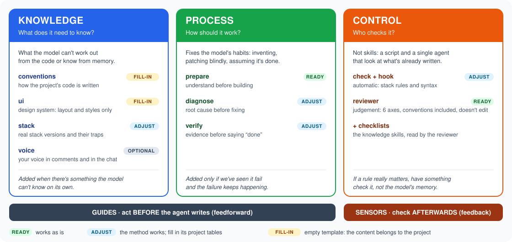
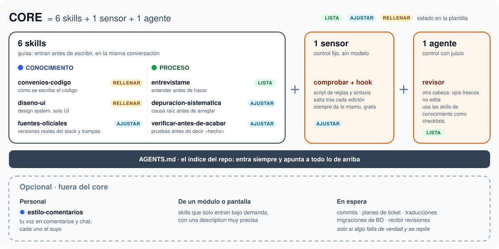
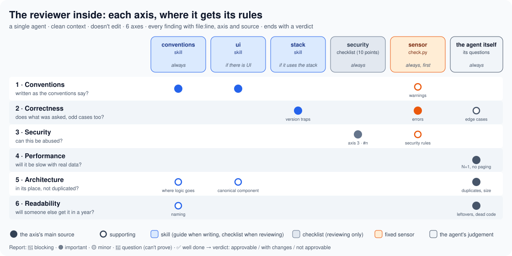

# Core guide: what each piece does, when it kicks in and what to fill in

🌐 **English** · [Español](SKILLS-GUIDE.es.md)

This guide is the template's **usage map**: which pieces it has, what type each one is, when in the work it acts and how much has to be filled in for a new project. How to set it up is in the [README](README.md); where everything comes from, in [RESEARCH](RESEARCH.md).

> **The idea in one line:** agent = model + harness. **Guides** tell the agent what to know and how to work *before* it writes; **sensors** check *afterwards* what it wrote. Guides only: rules nobody checks. Sensors only: an agent that repeats the same mistakes.

---

## 1. The 3 types of piece



| Type | Question | What it covers | Pieces |
|---|---|---|---|
| 🔵 **Knowledge** | what does it need to know? | what the model can't work out from the code or know from memory | `code-conventions`, `ui-design`, `official-sources`; optional: `comment-style` |
| 🟢 **Process** | how should it work? | the model's habits: inventing requirements, patching blindly, saying "done" without testing | `interview-me`, `systematic-debugging`, `verify-before-done` |
| 🟠 **Control** | who checks it? | looking at what's already written, with a tool (fixed) or with another model (judgement) | `check` + hook, `reviewer` |

Knowledge and process are **guides** (skills, `SKILL.md`). Control is **sensors**: they aren't skills, but a script and **a single agent**. The reviewer uses the knowledge skills as checklists (§6).

**State in the template:**
- **READY:** works as is.
- **ADJUST:** the method works; its project tables have to be filled in.
- **FILL-IN:** template with its concept (what it is for and what it prevents); the content belongs to the project.
- **OPTIONAL:** outside the core (`comment-style`).

## 2. What the core is



**Core = what applies to any task in the project, whatever the module:**

> **6 skills + 1 sensor + 1 agent**, on top of `AGENTS.md`

| Piece | What it is | State in the template |
|---|---|---|
| **6 skills** | knowledge: `code-conventions`, `ui-design`, `official-sources`. Process: `interview-me`, `systematic-debugging`, `verify-before-done` | 6 FILL-IN, each with its concept |
| **1 sensor** | `check` + hook | ADJUST (`MARKER`, `RULES`…) |
| **1 agent** | `reviewer` | READY |
| **base** | `AGENTS.md`, the index that always loads | `AGENTS.template.md` |

It can also be seen by where the content comes from:
- **From the project:** `AGENTS.md`, `code-conventions`, `ui-design`, the `official-sources` table and the sensor's `RULES`. Filled in for each project, or pointed at the team's repo if it already has them.
- **From the method:** the three process skills, the sensor engine and the `reviewer` agent. They work for any project without touching them (or almost).

**Optional · outside the core:**
- **Personal:** `comment-style`, your voice in comments and chat. Everyone would have their own.
- **What belongs to one module or screen:** skills that only load on demand, with a very precise `description` so they don't fire on every task.
- **What's on hold:** commits, ticket plans, translations, migrations, receiving reviews. They only come in if something really fails and keeps failing (§6).

**Tests aren't a skill:** they are a sensor, split across the skills that already exist. How they are written goes in `code-conventions`; when they are born, in `systematic-debugging` (the reproduction of a bug becomes its regression test); running them as evidence, in `verify-before-done`; and a plan's "how it's checked" can be one. The agent writes them; the user decides the cases. Strict TDD stays optional ([OPTIONAL-SKILLS](OPTIONAL-SKILLS.md)), for projects with a test base.

## 3. The workflow


| Phase | What happens | Pieces |
|---|---|---|
| **0 · Start** | when the session opens, the repo index and your way of talking load | `AGENTS.md` (always), `comment-style` (`SessionStart` hook in Claude) |
| **1 · Understand** | if what's asked isn't clear: questions one at a time, looking at the repo first. If it's big (3+ files, a new screen or component, several layers): a short plan by layers that you approve before any edit. If it's a bug: reproduce, find the layer and one hypothesis at a time | `interview-me`, `systematic-debugging` |
| **2 · Build** | writes with the conventions, the design system if it's UI and the stack's real versions. **After every edit**, the hook runs the checker: if there's an error, Claude fixes it before going on (the orange loop) | `code-conventions`, `ui-design`, `official-sources`, `check` |
| **3 · Check** | before saying "done": command run and output read, or the browser if it's a screen. Whatever can't be tested is said: "Not checked" | `verify-before-done` (+ the checker by hand in Copilot) |
| **4 · Review and close** | in-depth review with a clean context, conventions included, using the knowledge skills as checklists. It doesn't edit: you decide what gets applied and you commit | `reviewer` |

If something isn't done in phase 3, back to 2. If a bug shows up in 2, it goes through `systematic-debugging`.

**This flow is what the model receives**, in a short version (the order of the phases, the sensor and the agent): it's the content of `claude\CLAUDE.md`, which the `SessionStart` hook injects into every Claude session, and of `copilot\<project>.instructions.md`, which Copilot (VS Code chat and CLI) always loads from `~/.copilot` through a hardlink. It's the **router**: it says *when* each piece comes in; the *what* stays in each skill. It isn't repeated in `AGENTS.md`: Claude would load both and the flow would show up twice. The router always loads, but it only sets the order: whether each skill loads still depends on its `description` (or on typing `/name`).

**How the router is written:** short orders tied to each moment ("**BEFORE** writing code: load the conventions", "**AFTER** every change: run the sensor", "**BEFORE** saying done: show the output"). Tested with a local model: with a descriptive router it skipped the conventions and the sensor; with this format it followed them.

**Language:** write the skills, and above all their `description`, in the language you talk to the model in. The model matches your requests against the descriptions, and instructions in your language keep its answers and comments in that language too. The template comes in English: if you work in another language, translate them when you fill them in.

## 4. Cards

### 🔵 `code-conventions` · FILL-IN
- **What:** how the project's code is written: stack, naming, where logic goes, database, frontend, anti-patterns and formatting.
- **What to fill in:** the template's sections, with one-line rules that always apply (700 words max). If the team already has conventions in its repo, just a pointer to that file.
- **Kicks in:** on its own, before writing or reviewing any code.

### 🔵 `ui-design` · FILL-IN
- **What:** the design system: tokens, canonical components, screen patterns, responsive.
- **What to fill in:** the sections. If it grows, an index here and the detail in side files read on demand.
- **Kicks in:** on its own, **only** for layout, styles or UI components.

### 🔵 `official-sources` · FILL-IN
- **What:** the stack's real versions, their traps and the order for looking things up: repo → traps → official docs for that version.
- **Covers:** the model writing the latest version of every library from memory. Seen in practice: a local model used `slot-scope` (Vue 2.5) in a project on Vue 2.3: the slot came out empty with no warning.
- **What to fill in:** the stack table (version, where it shows, docs for that version) and the traps, one line per trap with what **is** used.
- **Kicks in:** on its own with good models. With small local models, by hand: `/official-sources`.
- **Complete example:** `official-sources` in [examples](examples/README.md), to copy or take ideas from.

### 🔵 `comment-style` · OPTIONAL (outside the core)
- **What:** your voice: how you want comments (length, tone, when yes and when no) and the tone of the chat.
- **What to fill in:** your rules and, in the detail, **real examples of yours**. If you don't care how the agent comments, delete it.
- **Kicks in:** at the start of the session: in Claude, through the `SessionStart` hook; in Copilot, because its router asks for it. Otherwise, `/comment-style`.

### 🟢 `interview-me` · FILL-IN
- **What:** when a ticket isn't clear, to the agent or to you. First it **looks in the repo** at what that does today; then a hypothesis with a %, **one question at a time with its guess**, and a summary with a mandatory "Out" line. What only the customer knows goes on a list of **questions for the customer**.
- **And plans:** if the task is big, it turns it into a 10-20 line plan with no code (steps by layer, each with how it's checked, what it reuses, what isn't touched) plus a check of what usually gets forgotten in the project. You approve it before any edit. Inspired by superpowers' `writing-plans`, without its code per step, its commits or its subagents. It lives inside `interview-me` so the skill count doesn't grow.
- **Optional:** what this project's tickets usually leave out, and what its plans usually forget.
- **Kicks in:** when you ask for it ("interview me", "I don't know what this ticket means") or if the ticket doesn't make clear the what, for whom or why. Never on mechanical tasks.
- **Complete example:** `interview-me` in [examples](examples/README.md), to copy or take ideas from.

### 🟢 `systematic-debugging` · FILL-IN
- **What:** no root cause, no fix. Reproduce → follow the data through the layers → one hypothesis at a time → a single fix. **After 3 failed fixes, stop**: the problem is in the design.
- **What to fill in:** the table of the application's layers and how to look at each one, and the project's own traps.
- **Kicks in:** on its own, with a bug or an error, before proposing any fix.
- **Complete example:** `systematic-debugging` in [examples](examples/README.md), to copy or take ideas from.

### 🟢 `verify-before-done` · FILL-IN
- **What:** no "done" without a check run in that same message, and an honest output: "Checked" / "Not checked".
- **Covers:** seen in practice: a strong model said "validated with no editor errors" without running anything.
- **What to fill in:** the table rows with the real commands (tests, lint, build…).
- **Kicks in:** on its own, when about to finish something or before a commit.
- **Complete example:** `verify-before-done` in [examples](examples/README.md), to copy or take ideas from.

### 🟠 `check` + hook · ADJUST
- **What:** `personal\scripts\check.py`, standard library only.
  - Runs the `RULES` (regexes with `ERROR` or `WARNING`) **only over the lines changed** against HEAD, not the whole file: that way old code makes no noise and style conventions (`var`, long lines…) can go in without thousands of warnings. To audit a whole file, `--all`.
  - Compiles `.py` files with the project's Python.
  - Runs `node --check` on `.js` files that carry no template marks.
  - Says which files it checked and which it skipped (minified, generated): "nothing to check" isn't an OK.
- **What to fill in:**
  - `MARKER`: a file that only exists in that repo. Mandatory if you work on other projects too.
  - `PROJECT_PYTHON`.
  - `RULES`: the `official-sources` traps a regex can catch. It's the most reliable way to stop them coming back.
- **Kicks in:**
  - **Claude:** automatically, after **every** edit (the plugin's `PostToolUse` hook). An error reaches it as blocking and it fixes it before going on.
  - **Copilot:** there's no hook; the router orders it, or you run it:
    ```bash
    py -3 <HARNESS>/personal/scripts/check.py
    ```
    (With no arguments it checks what changed in git.)

### 🟠 `reviewer` · READY
- **What:** the harness's **only agent**. An in-depth review with a clean context, on 6 axes. **It doesn't edit:** every finding comes with `file:line`, its axis and its source, and the proposed fix (mechanical ones as an exact change); it ends with a verdict. Sources still not filled in are skipped, and it says so. If nothing is pending because you already committed, it reviews the session's commits.



- **Sources per axis:** the diagram above is the table the agent itself carries. The rule is to **apply each source only to its axes**:
  - `code-conventions` → 1, 5 and 6;
  - `ui-design` → 1 and 5;
  - `official-sources` → 2;
  - `checklists\security.md` → 3, cited as `axis 3 · #n`;
  - the sensor → 2 (errors) and 1 (warnings).

  Performance and most of readability are the agent's judgement.
- **Skill or checklist:** "checklist" isn't a file type, but how the reviewer uses a source. The knowledge skills play two roles: the main agent loads them **before** writing (guide) and the reviewer reads them **afterwards** as a checklist. What's only useful for reviewing (today, security) goes in `personal\checklists\`: it's in no catalogue and the main agent doesn't load it. If one day it has to guide the writing too, it's promoted to a skill.
- **What to adjust:** the "how it shows in the code" column of `checklists\security.md`. Optional: the project's traps that must always be checked and other checklists of your own in `personal\checklists\`.
- **Kicks in:** when the session closes, before the commit or the PR, or to review a branch.

## 5. How each piece comes in

| Piece | Claude Code | Copilot (VS Code) |
|---|---|---|
| `AGENTS.md` | always, at startup | always |
| `comment-style` | `SessionStart` hook | the router asks for it at the start; otherwise, `/comment-style` |
| `code-conventions`, `ui-design` | on its own, through its `description` | on its own |
| `official-sources`, `systematic-debugging`, `verify-before-done` | on its own, through its `description` | on its own, with the router marking the moment; if a local model skips it, `/name` |
| `interview-me` | when you ask for it, the ticket is ambiguous or the task is big (plan) | same, or `/interview-me` |
| `check` | **automatic** after every edit | the router orders it after every change, or by hand |
| `reviewer` | when the session closes or by hand (subagent) | same (agent picker) |

**To know whether a skill came in:**
- **Claude:** the answer shows the skill being run (`/<project>:…`).
- **Copilot:** expand the answer's used references and see whether the `SKILL.md` is there. For the router: command palette → "Chat: Configure Instructions" → `copilot-instructions` should be listed (only once).

If it doesn't come in when it should, **improve the `description` first** (concrete words that catch on); forcing it is the last resort.

## 6. Before adding something new

Every skill costs even when unused: its `description` is always in the catalogue, and the more there are, the more often the wrong one fires. The criterion:

| Type | Add it when… | Don't add it if… |
|---|---|---|
| 🔵 Knowledge | there's something the model **can't know** or work out from the code | it's already in the conventions or shows when reading the repo |
| 🟢 Process | we've **seen** the model fail this way, and it keeps happening | it's "just in case" or you do it yourself in ten seconds |
| 🟠 Control | a rule matters and a tool can check it | it depends on the judgement of each case (that goes to the `reviewer`) |

If a specific failure keeps happening, first see whether it fits as a **new rule in `RULES`**: it's the most reliable and costs no context. What could be added given a signal, and what's better left out, is in the [OPTIONAL-SKILLS](OPTIONAL-SKILLS.md) catalogue.

### A single agent; other reviewers, as skills

Having many reviewers became fashionable (security, performance, accessibility…). Not here: **a new agent only pays off** when you need fresh eyes, different permissions or to isolate heavy work. The `reviewer` and the search agents the tools bring already cover all three.

Every subagent starts with no context, spends quite a few more tokens and loses part of what it finds when it hands back the result. And several reviewers go over the same diff several times.

**If you need a "reviewer for X":**
1. Write it as a **skill** with its checklist (`accessibility-review`, for example).
2. Add it to the `reviewer`'s checklist table, with its "when".
3. Whatever a regex can check, to `RULES`.

That way there's still one pass, one report and an agent that doesn't touch the code.

How to write a skill that works is in [README §4](README.md#4-day-to-day).
